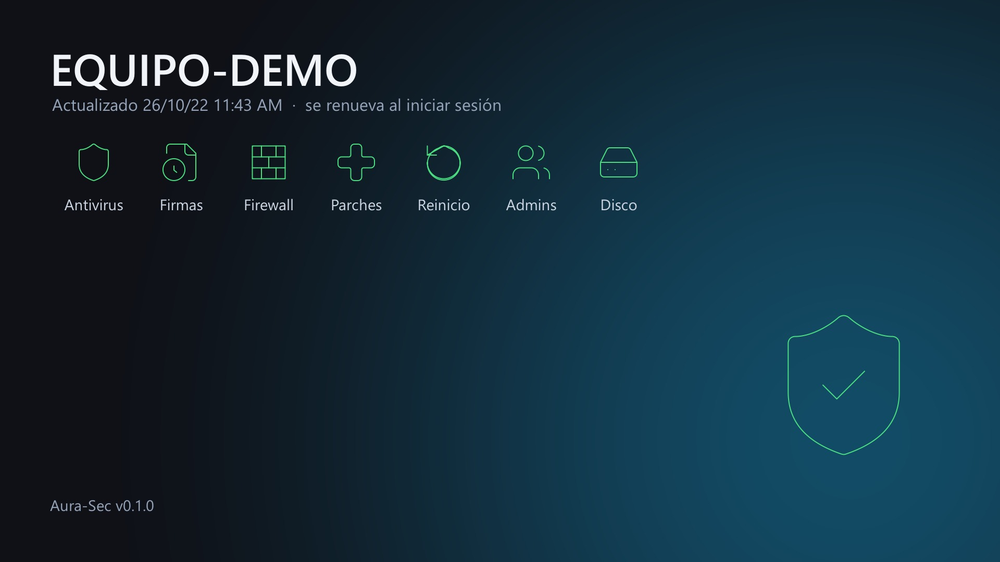
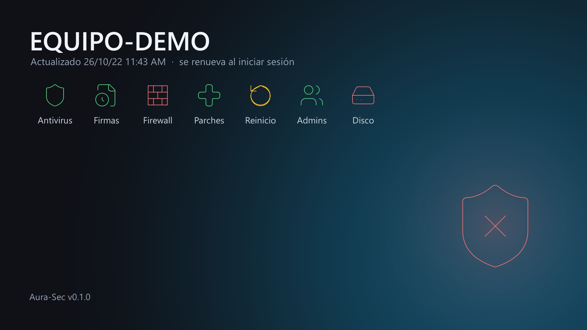

<div align="center">

# 🛡️ Aura-Sec

**La seguridad de tu PC, de un vistazo. En el wallpaper.**

[](https://github.com/slider-github/aura-sec-releases/releases/latest)
[](https://github.com/slider-github/aura-sec-releases/releases/latest)
[](https://github.com/slider-github/aura-sec-releases/releases)


 

*Izquierda: todo en orden 🟢 · Derecha: firewall apagado, reinicio pendiente y disco lleno 🔴*

</div>

---

## 💡 La historia

Soy **Martin Berra**, IT Manager en **Slider** y entusiasta de la IA. 🤖

Scripts para chequear la postura de un equipo tengo de sobra. El problema nunca fue *obtener* el dato: fue que **el dato no se ve**. Vive en una consola, en un reporte o en un script que hay que acordarse de correr, y el que se sienta en la máquina no se entera de nada.

Así que, de la mano de la IA, llevé esos chequeos a donde no se pueden ignorar: **el wallpaper**. 🎯 Iniciás sesión, mirás el escritorio y ya sabés si esa máquina está bien. Sin correr nada, sin abrir consolas ni portales. Un solo vistazo que unifica Defender, firewall, parches, reinicios, admins y disco.

> 🛡️ Un ícono por control, un color por estado y un escudo que resume todo. Si está verde, seguí trabajando. Si está rojo, ya sabés por dónde empezar.

---

## 👀 Qué te muestra

**Un ícono por control, siempre a la vista, con el color de su estado.** El escudo grande toma el color del peor de todos. Arriba, una nota chica te dice cuándo se generó: es una foto del inicio de sesión, no un monitor en vivo.

| | Chequeo | 🟢 OK | 🟡 Atención | 🔴 Problema |
|---|---|---|---|---|
| 🛡️ | **Antivirus** (Defender u otro registrado en Windows) | Activo | | Ninguno activo |
| 🕒 | **Firmas** del antivirus | Hasta 2 días (Defender) o al día (otro) | 3 a 7 días o desactualizadas | Más de 7 días |
| 🧱 | **Firewall** (Windows u otro registrado) | Activo | | Apagado sin otro que lo reemplace |
| ➕ | **Parches** de seguridad | Al día | Faltan de seguridad | Faltan críticos o importantes |
| 🔄 | **Reinicio** pendiente | No | Sí | |
| 👥 | **Admins** locales | Hasta 5 | Más de 5 | |
| 💾 | **Disco** C: | 20% libre o más | Menos de 20% | Menos de 10% |

⚪ **Gris** = no se pudo leer el dato. Para el escudo, "no sé" nunca cuenta como "está bien".

¿Usás otro antivirus (ESET, Sophos, etc.)? 🤝 Aura-Sec lo reconoce a través del Centro de Seguridad de Windows: no te marca Defender apagado como problema y la nota de arriba te dice cuál te protege.

Y si es una máquina virtual, la nota de arriba te dice en qué plataforma corre (VMware, Hyper-V, etc.). 🖥️

---

## 🔒 Hecho para ser confiable

Una herramienta de seguridad no puede ser un riesgo nuevo. Por eso:

- 🏠 **100% local** — no manda datos de tu equipo a ningún lado.
- 🔑 **Admin para instalar, nada más** — se instala una vez como administrador. Después, en cada inicio de sesión, Aura-Sec corre **con permisos comunes, sin elevar**, aunque el usuario sea admin: no necesita más para leer el estado, y así un error en Aura-Sec no puede tocar el sistema.
- 👁️ **Solo lectura** — mira, no cambia nada de la configuración.
- 👑 **Solo para admins locales** — Windows lo arranca únicamente cuando inicia sesión un administrador local. El resto de los usuarios conserva su wallpaper.
- 🌐 **Casi sin red** — solo consulta Windows Update (para los parches) y si hay una versión nueva de Aura-Sec. Nada más.
- ↩️ **Reversible** — guarda tu wallpaper anterior y lo devuelve cuando querés.

---

## 🚀 Instalar

1. Bajá `aura-sec.exe` de la [última versión](https://github.com/slider-github/aura-sec-releases/releases/latest).
2. 🔐 **Verificá que sea el original.** En PowerShell, en la carpeta donde lo bajaste, este comando compara tu archivo contra el SHA-256 publicado de la última versión y te dice si coincide:
   ```powershell
   $pub = Invoke-RestMethod https://updates.slider.cloud/aura-sec/latest.json
   if ((Get-FileHash .\aura-sec.exe).Hash -eq $pub.sha256) { "OK: es el original (v$($pub.version))" } else { "ATENCION: NO coincide, no lo instales" }
   ```
   ¿Bajaste una versión anterior? Su SHA-256 está en la descripción de esa versión, en [Releases](https://github.com/slider-github/aura-sec-releases/releases). Compará a ojo con `(Get-FileHash .\aura-sec.exe).Hash`: tienen que ser iguales los 64 caracteres.
3. Abrí **Terminal (Administrador)** y corré:
   ```powershell
   .\aura-sec.exe -instalar
   ```
4. Cerrá sesión y volvé a entrar. ✨ En unos segundos aparece el wallpaper.

| Quiero... | Comando |
|---|---|
| ⬆️ Actualizar | Bajar la nueva y correr `-instalar` otra vez |
| ↩️ Volver a mi wallpaper (sin desinstalar) | `aura-sec.exe -restaurar` |
| 🗑️ Desinstalar | `"C:\Program Files\Slider\Aura-Sec\aura-sec.exe" -desinstalar` (como administrador) |

---

## 🔔 Actualizaciones

Cuando sale una versión nueva, **el propio wallpaper te avisa** con una línea en amarillo. Aura-Sec **no se actualiza solo** 🚫: un programa de seguridad que baja y ejecuta código por su cuenta es justo lo que buscaría un atacante. Vos decidís cuándo actualizar.

---

## ❓ Preguntas rápidas

<details>
<summary><b>¿Por qué un wallpaper y no una app?</b></summary>

Porque el wallpaper lo ves siempre, sin hacer nada. Una app hay que acordarse de abrirla. 😉
</details>

<details>
<summary><b>¿Se actualiza en tiempo real?</b></summary>

Se genera una vez al iniciar sesión. Es una foto del estado en ese momento, con la hora a la vista.
</details>

<details>
<summary><b>¿Dónde está el código?</b></summary>

Este repo solo publica los ejecutables y sus SHA-256. El código vive en un repo privado de Slider.
</details>

---

<div align="center">

Hecho con ☕, curiosidad y una mano de la IA en **Slider** 💙

</div>
